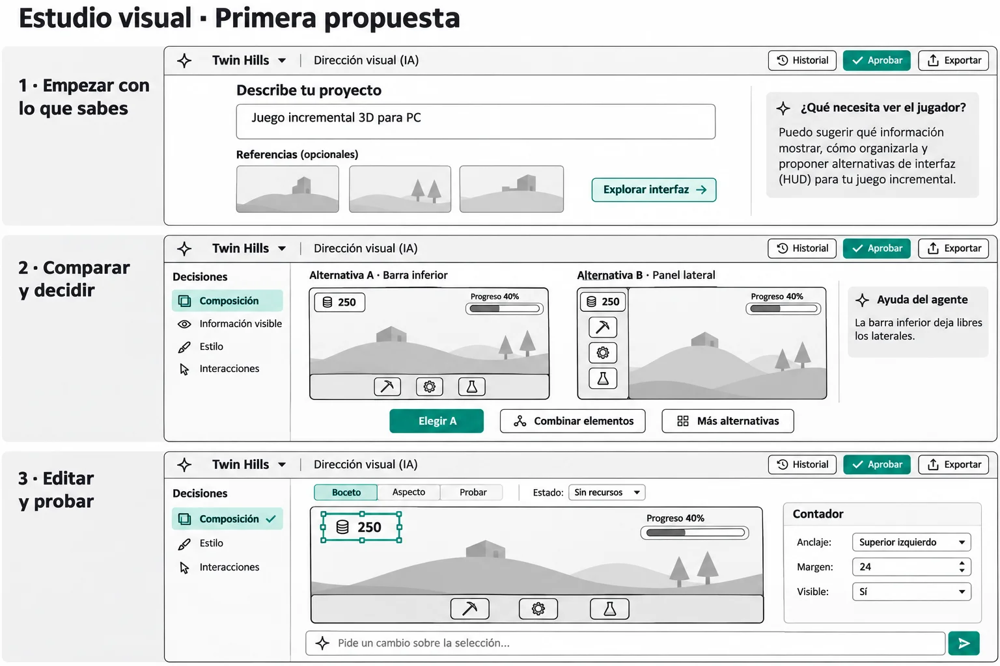

# Visual Studio Design

Estudio personal de dirección visual asistido por Claude Code. Permite descubrir, comparar, editar, probar y especificar interfaces de videojuegos, aplicaciones web y móviles antes de implementarlas.

**Estado: definición lista para comenzar la implementación. No hay todavía una aplicación ejecutable.** Este repositorio contiene especificaciones, contratos, ejemplos y una secuencia de desarrollo con criterios de aceptación. No confundir el boceto de interfaz con una captura de software funcionando.

## Empezar a implementar

1. Leer [AGENTS.md](AGENTS.md) y [el índice de documentación](docs/00-index.md).
2. Seguir [START-HERE.md](START-HERE.md). El primer trabajo es H0: estructura del monorepo y prueba de integración real con Claude Code.
3. Implementar los hitos de [ROADMAP.md](ROADMAP.md) en orden. H1 entrega el editor manual con persistencia; H4 incorpora el agente al recorrido completo.
4. No reabrir decisiones de producto ya cerradas. Resolver detalles de implementación dentro de los contratos y registrar desviaciones justificadas.

## Base acordada

- Aplicación web para un único propietario, alojada en su servidor.
- Editor autónomo: mover, editar, comparar y exportar no exige llamar a la IA.
- Lienzo central, decisiones/pantallas a la izquierda, inspector a la derecha; asistencia contextual.
- Decisiones visuales acompañadas de previsualizaciones, incluso bocetos geométricos.
- Un mismo documento evoluciona entre boceto, aspecto y prototipo; variantes comparables y edición por regiones.
- Claude Code se ejecuta como proceso gestionado por un servicio dedicado, autenticado con `claude setup-token`. No se sustituye por una API de pago por tokens.
- La fuente de verdad es el proyecto persistente, independiente de las conversaciones y del proceso de Claude.
- Salida: contrato de diseño versionado para agentes de programación.
- Twin Hills es una fixture ilustrativa de validación, no una dependencia ni una especificación oficial del juego.

## Stack elegido para implementar

Vue 3 + TypeScript + Vite + Pinia; Node.js 24 LTS + Express 5; PostgreSQL 17 con documentos JSONB y migraciones SQL; renderer DOM/CSS compartido; Playwright para capturas y pruebas; servicio Node que administra la CLI de Claude Code y herramientas MCP. Despliegue Docker Compose tras un proxy HTTPS. Detalles y razones en [arquitectura](docs/03-architecture.md).

## Documentos principales

| Documento | Contenido |
| --- | --- |
| [Producto](docs/01-product.md) | Requisitos, alcance, exclusiones y origen de decisiones |
| [Experiencia](docs/02-experience.md) | Pantallas, comparación, edición y estados de la aplicación |
| [Modelo](docs/04-design-model.md) | Documento común, layout, componentes y simulación |
| [Persistencia](docs/05-persistence.md) | Guardado, alternativas, revisiones, historial y concurrencia |
| [Agente](docs/06-agent.md) | Claude Code, herramientas, permisos y recuperación |
| [API](docs/07-api.md) | Endpoints, operaciones y errores |
| [Renderer](docs/08-renderer.md) | Boceto, aspecto, prueba y captura determinista |
| [Exportación](docs/09-export.md) | Paquete para implementación y exportación editable |
| [Despliegue](docs/10-operations.md) | Acceso privado, secretos, backups y operación |
| [Aceptación](docs/11-acceptance.md) | Pruebas concretas para dar el MVP por terminado |
| [Decisiones y fuentes](docs/12-decisions.md) | Elecciones técnicas y referencias consultadas |

## Boceto aprobado como organización



Se aprueba la organización, no una identidad visual definitiva. Corregir en implementación: poder elegir B, aprobar con alcance explícito y sincronizar los valores del escenario «Sin recursos». No copiar literalmente esos defectos del boceto.

## Verificación de estos materiales

```sh
python3 scripts/check_spec.py
```

Comprueba referencias locales, estructura y coherencia de los ejemplos y sus escenarios. No verifica una aplicación todavía inexistente ni sustituye las pruebas de los hitos.
