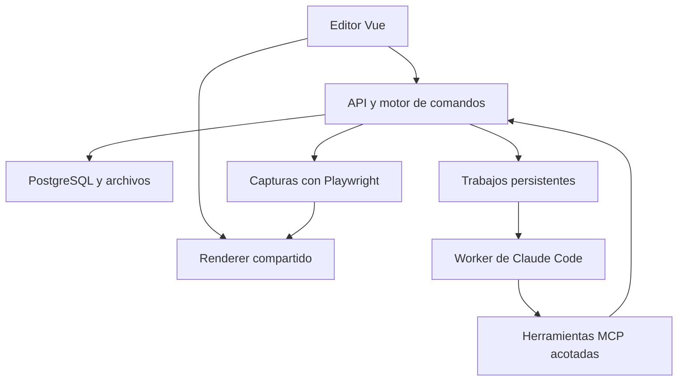

# Arquitectura elegida

## Decisiones técnicas delegadas

Monorepo npm workspaces, TypeScript estricto. Vue 3 + Vite + Pinia + Vue Router para aplicación y renderer. Node.js 24 LTS + Express 5 para API y worker. PostgreSQL 17 con pg y migraciones SQL; documentos JSONB más tablas de control. Zod para validación de entrada y esquemas compartidos; generar JSON Schema de herramientas desde esa misma definición. Vitest y Playwright. Fijar versiones exactas y lockfile durante H0.

Renderer DOM/CSS: corresponde bien a texto, filas/columnas, anclajes, formularios y estados; permite compartir render visible y capturas. No usar un canvas bitmap como fuente de verdad. Para formas simples se admite SVG generado por primitivas conocidas, nunca SVG arbitrario importado en MVP. No usar iframe de código generado por el agente.

## Límites de módulos

- domain: documento, validadores semánticos, operaciones puras, dependencias, composición de estilos, simulación. Sin acceso a red ni BD.
- renderer: componentes que interpretan domain. Sin lógica de negocio de Twin Hills ni llamadas Claude.
- web: selección, zoom, inspector, comparación, estado optimista y conciliación de respuestas.
- api: autentica, controla acceso/revisiones, ejecuta transacciones, gestiona archivos y exporta.
- agent-worker: consume trabajos, ejecuta la CLI, persiste eventos y cancelación. No importa credenciales del navegador.
- MCP bridge: stdio por ejecución, traduce herramientas al API interno con credencial temporal acotada. No tiene acceso directo a PostgreSQL.

Servicios despliegue: web estática y API pueden compartir proceso HTTP de producción; worker en contenedor separado; postgres y proxy HTTPS. Capturas en proceso Playwright del API con concurrencia 1 y límites, separable después. Evitar Redis, Kubernetes, buses externos o múltiples proveedores en MVP.

## Concurrencia y eventos

Una tarea de agente activa globalmente en MVP, cola persistente para el resto. Esto simplifica recursos y no impide editar manualmente. SSE del API al navegador con eventos persistidos y Last-Event-ID. Peticiones normales por HTTP JSON. No hace falta WebSocket.

Cada documento mutable tiene revisión entera creciente. Operaciones sobre current o alternativa comprueban expectedRevision. Un comando validado se persiste completo en transacción junto a la revisión, acción y actualización de decisiones. Cliente comparte validación para respuesta inmediata, pero nunca sustituye validación del servidor.

## Seguridad por construcción

Un propietario, sesión httpOnly, acceso privado a todos los documentos y recursos. Worker sin secretos de BD ni repositorio de implementación. El proceso Claude solo recibe herramientas de diseño permitidas. Propuestas y referencias son datos, nunca instrucciones privilegiadas. Capturas se sirven desde ruta interna conocida, no desde URLs arbitrarias aportadas por Claude.

## Rendimiento objetivo, pendiente de medir

Fixture de 200 nodos por pantalla: edición local fluida; objetivo p95 < 100 ms para actualizar preview tras propiedad sin IO. Guardado local servidor p95 < 500 ms sin contar WAN; capturas < 5 s una vez caliente Chromium. Registrar equipo y condiciones en H1/H6, no presentar estos objetivos como mediciones actuales. Límite inicial 1000 nodos/documento y 100 operaciones/comando, ajustable con evidencia.
